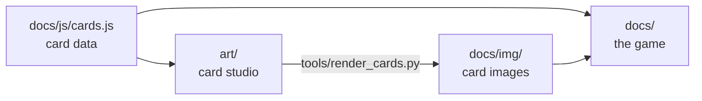

# All Is Bomb: web version

A browser version of the solo game of **[All Is Bomb](https://letibus.itch.io/aib)**, the card game by
**Blaž Urban Gracar** (Letibus Design), with all six expansions, the Hands helper pack, the Blitz
variant and the campaign.

**▶ [Play it](https://sergiomartinezcid.github.io/All-Is-Bomb/)**

## Support the original

All Is Bomb is a quick, puzzly 18-card game for one or two players: serve the princess the breakfast
she wants before everything explodes. Get it on **[itch.io](https://letibus.itch.io/aib)**:
- the print-and-play files and the rulebook are pay-what-you-want, so please pay what you can if you
  enjoy it;
- a printed deck is sold by [The Game Crafter](https://www.thegamecrafter.com/games/all-is-bomb).

The author's official page is [blazgracar.com](https://blazgracar.com).

This is an unofficial fan project, not affiliated with or endorsed by the author. The game, its rules
and its card names and texts are his work. The card art and the rules text in this repository were
made for this project: the original art and rulebook are not included. If you are the author and
would like something changed or removed, please open an issue.

## What's in it

- Every card of the base game and the expansions, with its action carried out for you. When a card
  needs a decision, the cards you can pick light up.
- Hovering a playable card shows which deck card its draw would equip.
- Undo at any moment, even halfway through an action, and restart the same shuffle.
- A panel with the win conditions of the current game and how close you are to each.
- The campaign, with its card removals and final score. Games in progress are saved in the browser.
- The full rules, with a diagram of the card layout.
- Works offline and can be installed as an app.

Keys: `Z` undo · `Esc` close. Right-click or long-press a card to zoom.

## How it's made



`docs/` is the whole site, plain HTML, CSS and JavaScript with no build step, and GitHub Pages
serves it as it is. It also runs straight from the folder, by opening `docs/index.html`, but offline
play and installing as an app need a web server, for example `python3 -m http.server -d docs`.

| File | What it holds |
| --- | --- |
| `docs/js/cards.js` | Every card: number, keyword, class, actions, expansion, campaign symbol |
| `docs/js/engine.js` | The rules: turns, card actions, win and loss checks, undo |
| `docs/js/ui.js`, `docs/style.css` | The table, card animations, panels and rules page |
| `docs/js/sound.js` | Small sound effects, synthesised in the browser |
| `docs/index.html` | The page and the rules text |
| `docs/img/` | Card images, expansion symbols and app icons |
| `docs/sw.js`, `docs/manifest.json` | Offline play and installation |
| `art/` | The card studio: card layout, illustrations and the papercut style |
| `tools/render_cards.py` | Renders every card from the studio into `docs/img/` |

### Card art

The card studio in `art/` draws each card from the data in `cards.js`: its layout (number, keyword,
name, class, action text, side) and an illustration. The illustrations in `art/scenes.js` tag their
shapes with roles (skin, hair, main colour, shadow…) rather than colours, and the papercut style in
`art/styles/paper.js` decides how to paint them and draws the card frame.

Open `art/studio.html?view=deck&style=paper` in a browser to see every card. After changing an
illustration or the style, render the cards again:

```sh
pip install pillow playwright && playwright install chromium
python3 tools/render_cards.py     # rewrites docs/img/cards/*.webp and docs/img/icons/*.webp
```

If the parts of the card move, update `ANATOMY` in `docs/js/ui.js` too, so the card diagram in
the rules points at them.

## Publishing

GitHub Pages serves the `docs/` folder straight from the repository. In the repository settings,
under Pages, set the source to *Deploy from a branch*, with the branch `master` and the folder
`/docs`. Every push to `master` then updates the site.

## License

The code, the card art and the rules text in this repository are under the [MIT license](LICENSE).
That covers only the work done for this project: the game All Is Bomb itself, with its design, card
names and card texts, belongs to Blaž Urban Gracar and Letibus Design.
